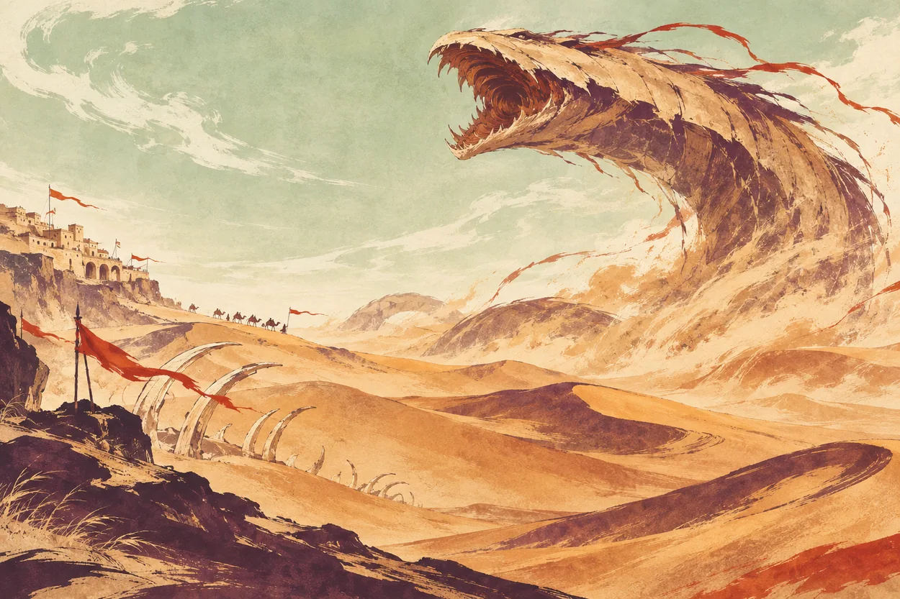

# BoF Atelier

An illustrated Field Guide for *Breath of Fire III* and *IV*. Keep it open beside the game when you need a direction, a chest location or a reminder of what those dragon genes do.

**[Open the Field Guide](#read-the-field-guide)** · [How to play the games](docs/PLAYING.md)

  
  

| [Breath of Fire III walkthrough](docs/FIELD-GUIDE.md#breath-of-fire-iii) | [Breath of Fire IV walkthrough](docs/FIELD-GUIDE.md#breath-of-fire-iv) |
| :--- | :--- |
| Find your way out of Dauna Mine, look up a master or try a dragon gene combination. | Follow Ryu and Fou-Lu, check a fork in Kurok or see what you can miss before leaving an area. |

## Read the Field Guide

Choose a game above. **Walkthrough** follows the story in order. **Field wiki** is for looking something up. Later stops stay hidden until you choose to see them. You can read either book on your phone while you play on another screen.

For an offline copy, open the guide and choose **Download for offline reading** at the foot of the page. Both books and their illustrations fit in one HTML file. Double-click it to read it again.

## I want to play

The Field Guide is ready to use. The Atelier desktop app is still in development and there's no player installer yet. If you're here for *IV* on Windows, the GOG edition is the shortest route. If you have one of the PlayStation games, the play guide starts with what you already own. [Play III or IV](docs/PLAYING.md)

## Help build Atelier

If a direction sends you to the wrong exit, tell us the game, the area and which way you came in. That's enough for a useful correction. [Report a guide correction](CONTRIBUTING.md#report-a-correction)

We're working towards an optional remaster of the art, animation and music in both games. You should always be able to go back to the originals. [What's next](docs/ROADMAP.md) · [Contribute](CONTRIBUTING.md) · [Developer setup](docs/PLAYER-DEVELOPMENT.md) · [Credits and licences](docs/LICENSING.md)

*An unofficial fan project. Breath of Fire belongs to Capcom.*

Started by 
