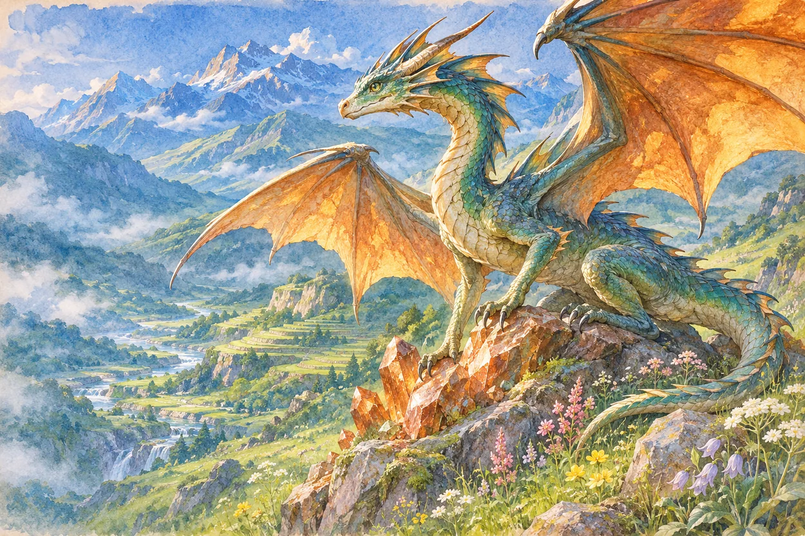

# BoF Atelier

Two illustrated books for *Breath of Fire III* and *IV*. Follow a route, find a chest or look up a dragon form.

| [Breath of Fire III](https://daniel-parke.github.io/BoF-Atelier/#bof3/walk) | [Breath of Fire IV](https://daniel-parke.github.io/BoF-Atelier/#bof4/walk) |
| :---: | :---: |
|  |  |
| [Walkthrough](https://daniel-parke.github.io/BoF-Atelier/#bof3/walk) · [Dragon genes](https://daniel-parke.github.io/BoF-Atelier/#bof3/genes) | [Walkthrough](https://daniel-parke.github.io/BoF-Atelier/#bof4/walk) · [Master growth](https://daniel-parke.github.io/BoF-Atelier/#bof4/masters) |

**Want to play?** The Atelier app is still in development. Our [play guide](docs/PLAYING.md) covers original PlayStation discs and the Windows edition of *IV*.

**Taking the guide offline?** Open either book and choose **Download for offline reading** at the foot of the page. Both volumes travel in that one file.

If we’ve sent you down the wrong path, [tell us the place and where you came in](https://github.com/Daniel-Parke/BoF-Atelier/issues/new?template=guide-correction.md). We’re also working on optional artwork, animation and music for both games. [Contribute](CONTRIBUTING.md) · [Roadmap](docs/ROADMAP.md) · [Credits](docs/LICENSING.md)

*An unofficial fan project. Breath of Fire belongs to Capcom.*

Started by 
